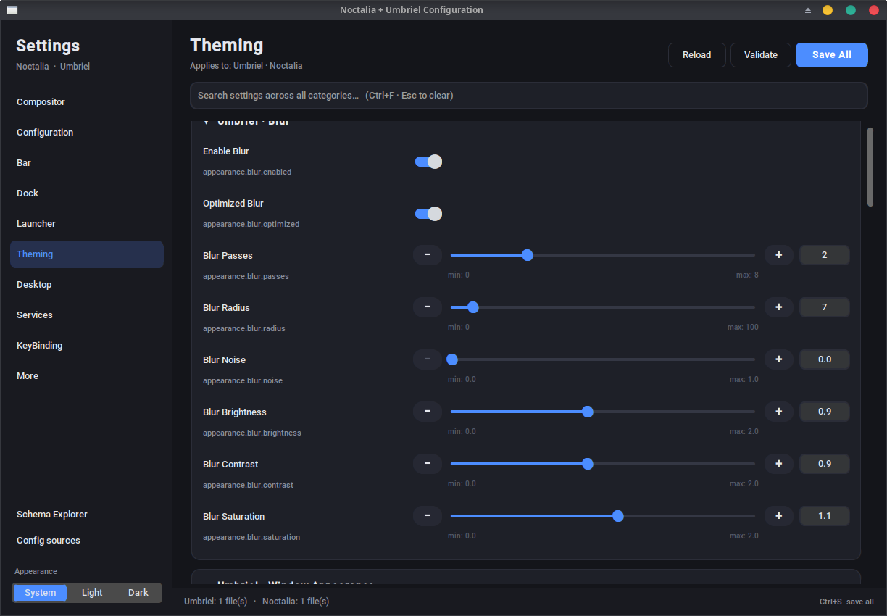

# Noctalia Util GUI

A desktop configuration editor for **Noctalia Shell** and **Umbriel**. Browse
settings in a searchable CustomTkinter interface, validate changes, and save
them back to their configuration files.



**Python 3.11+** · **CustomTkinter 6+** · **[MIT License](./LICENSE)**

[Features](#whats-included) · [Config files](#configuration-files) ·
[Install](#install-and-run) · [Tests](#project-layout)

## What’s included

### A unified settings workspace

- Sidebar sections for **Compositor**, **Configuration**, **Bar**, **Dock**,
  **Launcher**, **Theming**, **Desktop**, **Services**, **KeyBinding**, and
  **More**.
- Noctalia settings are discovered from its effective configuration; Umbriel
  has curated controls plus a live schema explorer.
- Search across categories with **Ctrl+F**. Press **Esc** in the search field
  to clear the query.
- Collapsible setting cards, an unsaved-changes indicator, status messages, and
  success/error notifications.
- **System**, **Light**, and **Dark** appearance modes.

### Controls matched to the setting

| Setting type | Control |
| --- | --- |
| Boolean | Toggle switch |
| Choice | Segmented control or dropdown |
| Number | Bounded slider with editable value, step buttons, and visible minimum and maximum |
| List | Comma-separated input, preserving string, integer, or float values |
| Color | Hex input, color picker, and Noctalia palette-role choices where available |
| Array of tables | TOML editor |
| Keybind | Dedicated add/edit/remove interface |

Numeric values are converted to real integers or floats before saving. Invalid
numbers block the save; fractional values are rejected for integer fields.
Sliders support configurable steps, and opacity controls use a `0.1`–`1.0`
range.

### Noctalia theming

- Select a theme source: `builtin`, `wallpaper`, `community`, or `custom`.
- Choose from documented built-in palettes: Ayu, Catppuccin, Dracula, Eldritch,
  Gruvbox, Kanagawa, Noctalia, Nord, Rosé Pine, and Tokyo-Night.
- Community and custom palette dropdowns discover local `*.json` palette files.
  Their filenames become the selectable palette names, and a configured name
  remains available even if its file is missing.
- `bar.default.layer` and `dock.layer` offer only `top` and `overlay`.

The Noctalia CLI does not provide a palette-list command, so built-in palette
choices use the documented list; community and custom choices are discovered
from disk.

### Umbriel schema explorer

Open **Schema Explorer** to browse the live schema from `umbriel config schema
--json`, including setting types, defaults, ranges, accepted values, and
descriptions. Eligible settings can be edited with TOML literals. Schema
templates and keys not supported by the installed schema are shown as
non-editable.

### Validate and save safely

- **Validate** checks all sources without writing files.
- **Save All** prepares and validates every source before writing any of them.
  Validation errors abort the save; warnings are shown before continuing.
- Generated TOML is parsed locally first, then checked with the matching CLI
  validator when it is installed:

  ```text
  umbriel config validate -c <temporary-file> --json
  noctalia config validate <temporary-file>
  ```

- Writes use a temporary file and atomic replacement. Existing files are backed
  up as `.bak`; changes made externally since loading are detected and require
  confirmation before overwrite.
- **Reload** asks before discarding unsaved edits.
- `Ctrl+S` runs **Save All**.

If a validator CLI is unavailable, the application still checks that generated
TOML parses and reports that external validation was skipped.

## Configuration files

| Source | Reads | Writes |
| --- | --- | --- |
| Umbriel | `$XDG_CONFIG_HOME/umbriel/config.toml` | The same file |
| Noctalia | `$XDG_CONFIG_HOME/noctalia/*.toml` and `$XDG_STATE_HOME/noctalia/settings.toml` | `$XDG_STATE_HOME/noctalia/settings.toml` |

By default, `XDG_CONFIG_HOME` is `~/.config` and `XDG_STATE_HOME` is
`~/.local/state`. `NOCTALIA_CONFIG_HOME` and `NOCTALIA_STATE_HOME` can override
those base directories for Noctalia; the application appends `/noctalia`.

Noctalia user TOML files are loaded in sorted order before the GUI override.
The **Configuration** section reports loaded files and paths. When available,
the Noctalia CLI supplies effective defaults using a credentials-omitting
export; parse warnings are shown in the source information. Noctalia include
directives belong in user TOML files; they are not applied from the GUI
`settings.toml` override.

Palette discovery uses:

- Community palettes:
  `${NOCTALIA_STATE_HOME:-$XDG_STATE_HOME}/noctalia/community-palettes/*.json`
- Custom palettes:
  `${NOCTALIA_CONFIG_HOME:-$XDG_CONFIG_HOME}/noctalia/palettes/*.json`

## Install and run

Python 3.11 or newer is required for the standard-library `tomllib` module.

```bash
python3 -m venv .venv
source .venv/bin/activate
python -m pip install -r requirements.txt
python main.py
```

Install the `noctalia` and/or `umbriel` command-line tools separately to enable
their full effective-config export, live schema, and external validation
features. The GUI can still read and edit the available files without those
commands, but CLI-dependent features will be unavailable.

## Project layout

- [`main.py`](./main.py) — CustomTkinter interface and user interactions.
- [`config.py`](./config.py) — configuration sources, schemas, TOML handling,
  validation, and persistence.
- [`number_input.py`](./number_input.py) — reusable bounded numeric slider.
- [`tests/test_config_smoke.py`](./tests/test_config_smoke.py) — config
  collection, type-preserving save, and choice-discovery smoke tests.

Run the smoke tests with:

```bash
python -m unittest discover -v
```
